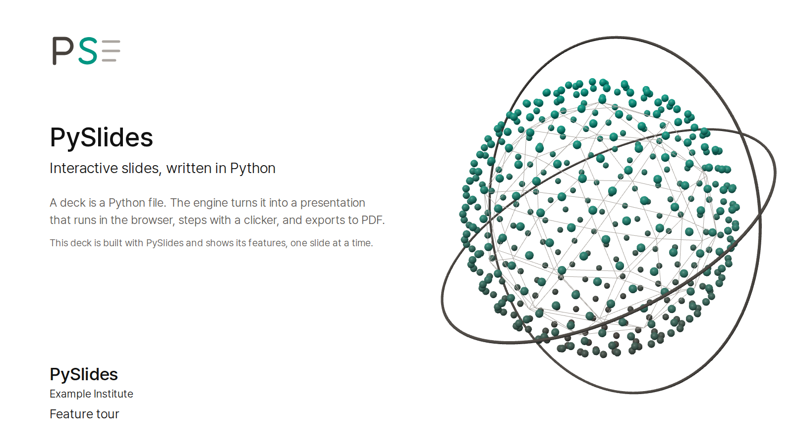
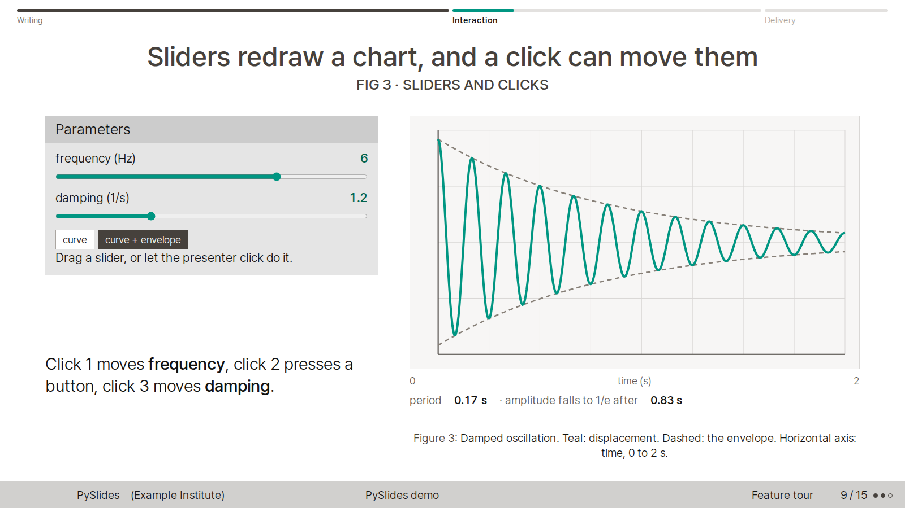
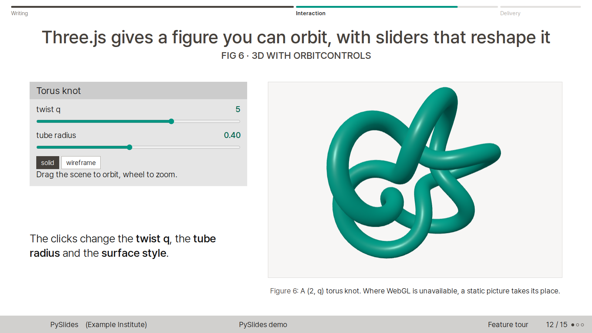
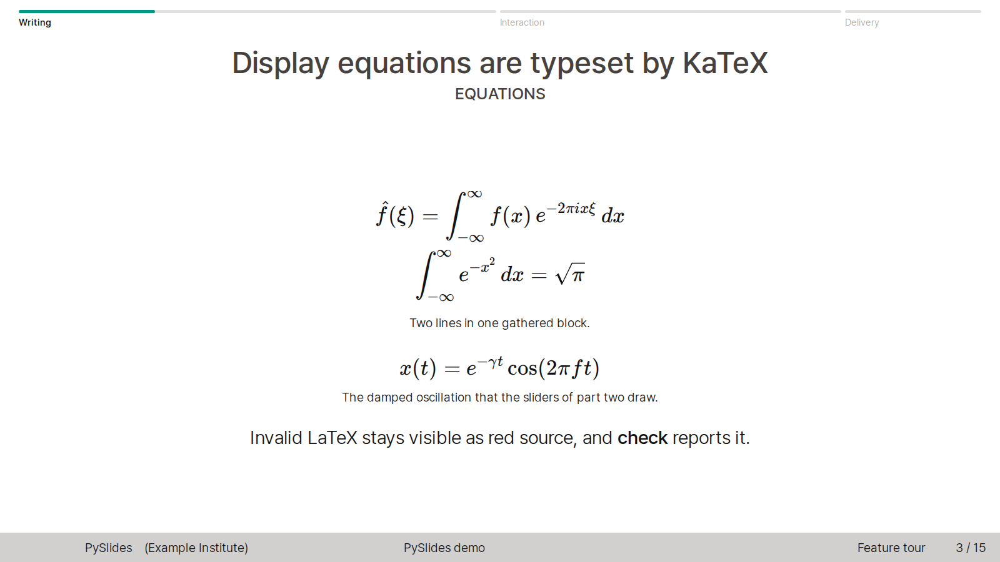

# PySlides

[English](README.md) | [한국어](README.ko.md) | [日本語](README.ja.md)

PySlides は、Beamer の Singapore テーマと seagull カラーテーマに倣ったスタイルのインタラクティブなスライドエンジンです。スライドは Python で書き、ブラウザで発表します。

- スライドは Python のオブジェクトとして書きます。数式は LaTeX で、同梱の KaTeX が組版します。
- インタラクティブなコンポーネントを使えます。スライダー、ボタン、グラフ、Three.js の 3D を入れられます。
- クリックステップ(steps)を設定できます。発表者のクリックで、コントロールが決めた値まで滑らかに動きます。
- PDF に書き出すと、すべてのスライドとすべてのステップが 1 ページずつ入ります。文字を選択できるベクター PDF も作れます。
- `check` コマンドは、すべての状態のスクリーンショットを撮り、はみ出し、LaTeX エラー、JavaScript エラーを検査します。

## スクリーンショット

| タイトルスライド | インタラクティブなコントロール |
|---|---|
|  |  |

| Three.js の 3D | KaTeX の数式 |
|---|---|
|  |  |

## クイックスタート

```bash
git clone https://github.com/BongHwi/pyslides-public.git
cd pyslides-public
python3 -m pyslides serve demo           # http://127.0.0.1:8765/
python3 -m pyslides new my-talk --title "My talk"
python3 -m pyslides serve my-talk
```

執筆ガイド: [AUTHORING.md](AUTHORING.md)(英語)、[AUTHORING.ko.md](AUTHORING.ko.md)(韓国語)。

## 必要な環境

- ビルドと発表には Python 3.11 以上が必要です(3.11 と 3.12 で確認しました)。
- `check`、`pdf`、テストには Node.js 18 以上が必要です。依存パッケージと Playwright 用の Chromium もインストールします。

```bash
npm ci
npx playwright install chromium
```

- `npm test` と `pdf --vector` のフォント検査には poppler-utils(`pdffonts`、`pdftotext`)が必要です。Debian や Ubuntu では `sudo apt install poppler-utils` で入ります。

発表だけなら Python だけで足ります。Playwright がブラウザを見つけられないときは、`PYSLIDES_BROWSER_EXECUTABLE` に chromium の実行ファイルのパスを指定します。

## コマンド

```bash
python3 -m pyslides new my-talk --title "My talk"        # create decks/my-talk from the template
python3 -m pyslides list                                  # list the decks
python3 -m pyslides serve my-talk                         # build and present at http://127.0.0.1:8765/
python3 -m pyslides build my-talk                         # build only (reloads the browser if a server is running)
python3 -m pyslides check my-talk                         # screenshot every slide and step -> decks/my-talk/export/check/index.html
python3 -m pyslides pdf my-talk                           # decks/my-talk/export/my-talk.pdf
python3 -m pyslides pdf my-talk --vector                  # selectable text, vector figures, PDF links (canvas/WebGL stays an image)
```

すべてのサブコマンドに `--help` があります。`serve` は `--port` と `--no-browser`、`check` と `pdf` は `-o`、`pdf` は `--scale`、`build`、`serve`、`check`、`pdf` は `--profile` を受け付けます。オプションの詳細は執筆ガイドにあります。

## デモ発表

`decks/demo` は PySlides を紹介する発表で、すべての機能を 1 回以上使っています。Three.js のタイトルグラフィックがあるタイトルスライド、インライン数式とディスプレイ数式、図と表、ステップカードと比較カード、スライダー・ボタン・クリックステップ、worker によるライブ計算、OrbitControls の 3D、ダイヤルのスライド、韓国語と日本語の文章、独自レイアウト、発表者ノートが入っています。

```bash
python3 -m pyslides serve demo
```

## プロファイル

プロファイルは、個人設定(作成者、所属、ロゴ、フォント)を発表とエンジンの外に置く仕組みです。`PYSLIDES_PROFILE` または `--profile` でプロファイルのフォルダを指定します。両方あるときはフラグが優先されます。フォルダには `profile.json` があり、`assets/` フォルダ(中に `profile.css`)は任意です。

```bash
export PYSLIDES_PROFILE=~/my-profile
python3 -m pyslides serve my-talk
python3 -m pyslides pdf my-talk --profile ~/my-profile
```

```json
{
  "author": "Your Name",
  "institute": ["Your Institute", "Your City"],
  "short_institute": "YI",
  "title_logos": ["logos/mark.svg"]
}
```

優先順位は、デフォルトテーマ、プロファイル、`Deck.theme` の順です。プロファイルがなければ、作成者、所属、ロゴは空です。規則とエラーは執筆ガイドのプロファイルの節にあります。

## クリッカーとダイヤル

- プレゼンテーション用クリッカーの PageDown と PageUp で、ステップを進めたり戻したりできます。スライダーやボタンにフォーカスがあっても動きます。
- `Slide(..., dial="id")` を使うと、F17(進む)と F16(戻る)を送るダイヤル装置で range input を回したり動画をスクラブしたりできます。デモ発表に動作するスライドがあります。
- `node tests/clicker-e2e.mjs --live` は、表示されるブラウザを開き、実際のクリッカーが送ったキーを `artifacts/clicker-live.json` に記録します。

## エージェントスキル

`skill/SKILL.md` は、PySlides の発表を作成、検査、書き出しするエージェントスキルです。クローンからインストールします。

```bash
bash skill/install.sh                    # default: ~/.claude/skills/pyslides/SKILL.md
SKILLS_DIR=/path/to/skills bash skill/install.sh   # another agent's skills folder
```

インストーラーは、クローンのパスと `origin` リモートの URL を埋め込みます。すでにインストール済みの `SKILL.md` があり内容が異なるときは、先に `SKILL.md.bak-<時刻>` にコピーして残します。

## 既知の制限

- ビルド結果は `/` で始まる絶対パスを使います。そのためドメインのルートでのみ動作し、`/repo/` のようなサブパスでは壊れます。
- 既定の PDF は画面キャプチャなので、文字を検索できません。`pdf --vector` は文字を選択できますが、`<canvas>` と WebGL は画像のままで、`src: local(...)` で宣言したフォントはホストフォント検査で確認できません。
- エンジンが出す画面上の文言は `Deck.lang`(`ko`、`en`、`ja`)に従います。それ以外の値では英語になります。

## テスト

```bash
npm test                  # engine end-to-end tests; results in artifacts/*.json
npm run test:demo         # end-to-end tests of the demo deck; starts its own server
```

`npm test` は scaffold、robustness、clicker、vector-pdf、profile の各スイートを実行します。どのスイートも、シェルに設定された `PYSLIDES_PROFILE` を無視します。Playwright がブラウザを見つけられないときは、`npx playwright install chromium` を実行するか `PYSLIDES_BROWSER_EXECUTABLE` を設定します。`test:demo` は `PYSLIDES_URL` があればそのアドレスをサーバーとして使います。

## リポジトリの構成

| パス | 内容 |
|---|---|
| `pyslides/` | Python エンジン: モデルとレンダリング(`core.py`)、ビルド(`build.py`)、CLI(`__main__.py`)、デフォルトテーマ(`theme.py`) |
| `static/` | ブラウザランタイム: `slides.js`、`steps.js`、`controls.js`、`theme.css`、フォント、KaTeX と Three.js |
| `tools/capture.mjs` | すべてのスライドとステップを順にキャプチャします。`pdf` と `check` が使います |
| `templates/new-deck/` | `new` コマンドがコピーするテンプレート |
| `decks/` | 発表の置き場所。`decks/demo` がデモ発表です |
| `skill/` | エージェントスキルとインストーラー |
| `docs/images/` | この README のスクリーンショット |
| [THEME_MAPPING.md](THEME_MAPPING.md) | Beamer の要素と HTML テーマの対応(英語) |

## ライセンスとサードパーティ

PySlides は MIT ライセンスで公開しています: [LICENSE](LICENSE)。リポジトリには KaTeX、three.js、Pretendard、LINE Seed JP、DejaVu フォントがそれぞれのライセンスで含まれており、[THIRD_PARTY_NOTICES.md](THIRD_PARTY_NOTICES.md) にまとめています。

## 作者

Lim Bong-Hwi (東京大学)
