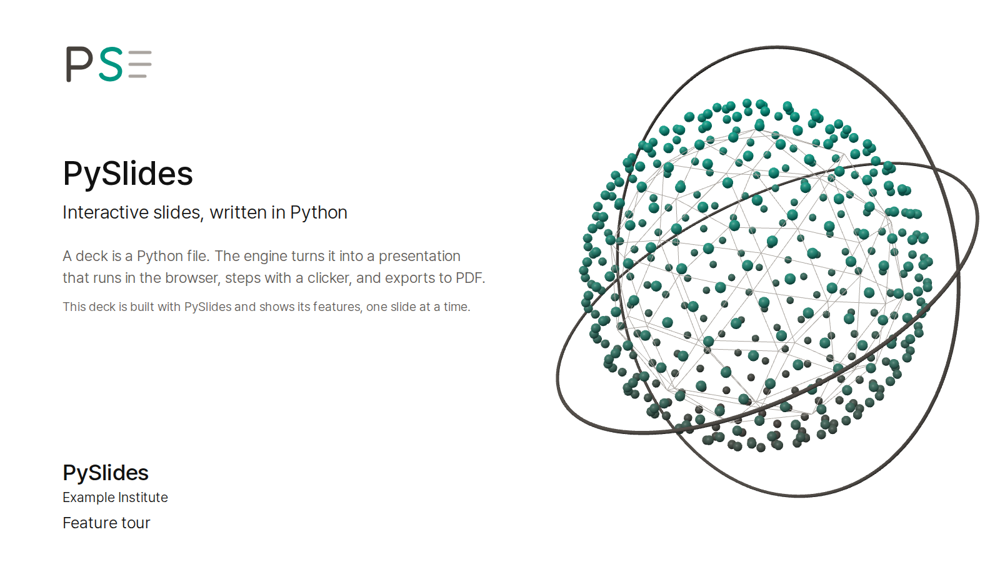
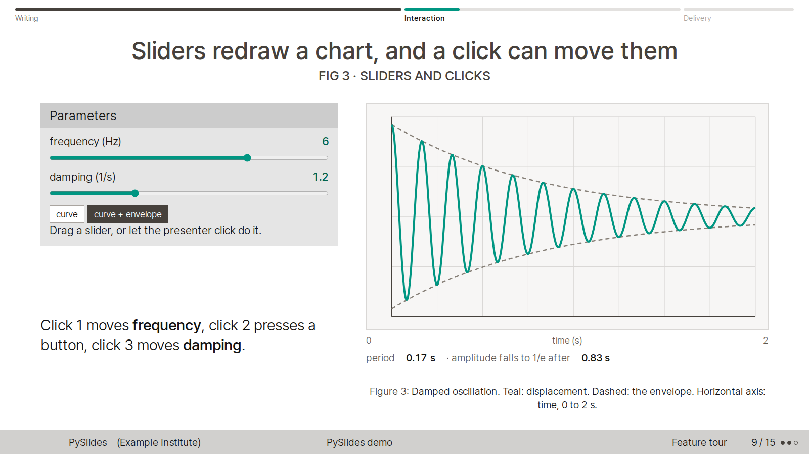
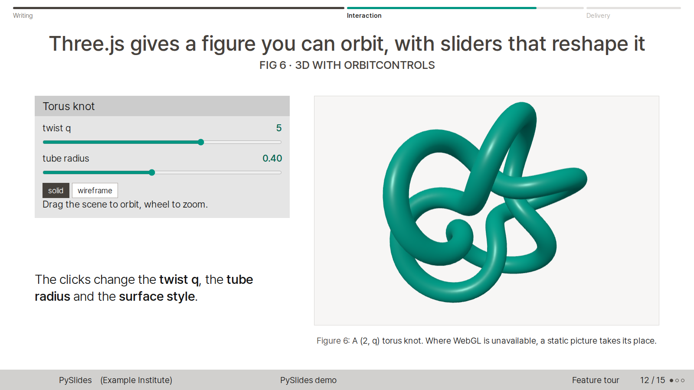
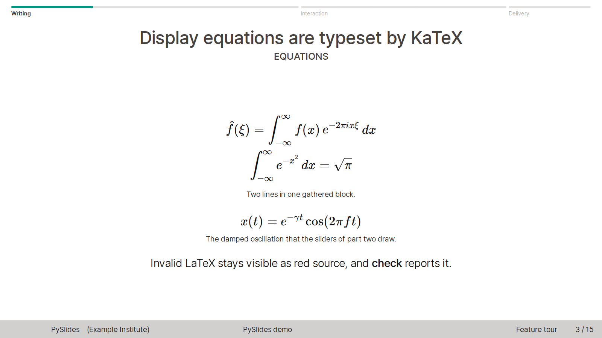

# PySlides

[English](README.md) | [한국어](README.ko.md) | [日本語](README.ja.md)

PySlides는 Beamer Singapore 테마와 seagull 색 테마를 따른 스타일의 인터랙티브 발표자료 엔진이다. 슬라이드는 Python으로 쓰고 브라우저에서 발표한다.

- 슬라이드는 Python 객체로 쓴다. 수식은 LaTeX이고, 내장된 KaTeX가 조판한다.
- 인터랙티브 컴포넌트를 쓸 수 있다. 슬라이더, 버튼, 차트, Three.js 3D를 넣는다.
- 클릭 단계(steps)를 둘 수 있다. 발표자의 클릭이 컨트롤을 정해진 값까지 부드럽게 움직인다.
- PDF로 내보내면 모든 장과 모든 단계가 한 쪽씩 들어간다. 글자를 선택할 수 있는 벡터 PDF도 만들 수 있다.
- `check` 명령은 모든 상태의 스크린숏을 찍고 넘침, LaTeX 오류, JavaScript 오류를 검사한다.

## 스크린숏

| 제목 장 | 인터랙티브 컨트롤 |
|---|---|
|  |  |

| Three.js 3D | KaTeX 수식 |
|---|---|
|  |  |

## 빠른 시작

```bash
git clone https://github.com/BongHwi/pyslides-public.git
cd pyslides-public
python3 -m pyslides serve demo           # http://127.0.0.1:8765/
python3 -m pyslides new my-talk --title "My talk"
python3 -m pyslides serve my-talk
```

작성 가이드: [AUTHORING.ko.md](AUTHORING.ko.md)(한국어), [AUTHORING.md](AUTHORING.md)(영어).

## 요구 사항

- 빌드와 발표에는 Python 3.11 이상이 필요하다(3.11과 3.12에서 확인했다).
- `check`, `pdf`, 테스트에는 Node.js 18 이상이 필요하다. 의존성과 Playwright용 Chromium도 설치한다.

```bash
npm ci
npx playwright install chromium
```

- `npm test`와 `pdf --vector`의 글꼴 검사에는 poppler-utils(`pdffonts`, `pdftotext`)가 필요하다. Debian이나 Ubuntu에서는 `sudo apt install poppler-utils`로 설치한다.

발표만 할 때는 Python만 있으면 된다. Playwright가 브라우저를 찾지 못하면 `PYSLIDES_BROWSER_EXECUTABLE`에 chromium 실행 파일 경로를 준다.

## 명령

```bash
python3 -m pyslides new my-talk --title "My talk"        # create decks/my-talk from the template
python3 -m pyslides list                                  # list the decks
python3 -m pyslides serve my-talk                         # build and present at http://127.0.0.1:8765/
python3 -m pyslides build my-talk                         # build only (reloads the browser if a server is running)
python3 -m pyslides check my-talk                         # screenshot every slide and step -> decks/my-talk/export/check/index.html
python3 -m pyslides pdf my-talk                           # decks/my-talk/export/my-talk.pdf
python3 -m pyslides pdf my-talk --vector                  # selectable text, vector figures, PDF links (canvas/WebGL stays an image)
```

모든 하위 명령에 `--help`가 있다. `serve`는 `--port`와 `--no-browser`, `check`와 `pdf`는 `-o`, `pdf`는 `--scale`, `build`, `serve`, `check`, `pdf`는 `--profile`을 받는다. 옵션 전체는 작성 가이드에 있다.

## 데모 발표

`decks/demo`는 PySlides를 소개하는 발표이고, 모든 기능을 한 번 이상 쓴다. Three.js 타이틀 그래픽이 있는 제목 장, 인라인 수식과 디스플레이 수식, 그림과 표, 단계 카드와 비교 카드, 슬라이더·버튼·클릭 단계, worker 실시간 계산, OrbitControls 3D, 다이얼 장, 한국어와 일본어 문장, 사용자 정의 레이아웃, 발표자 노트가 들어 있다.

```bash
python3 -m pyslides serve demo
```

## 프로필

프로필은 개인 설정(작성자, 소속, 로고, 글꼴)을 발표와 엔진 밖에 둔다. `PYSLIDES_PROFILE`이나 `--profile`로 프로필 폴더를 고른다. 둘 다 있으면 플래그가 이긴다. 폴더에는 `profile.json`이 있고, `assets/` 폴더(그 안에 `profile.css`)는 선택이다.

```bash
export PYSLIDES_PROFILE=~/my-profile
python3 -m pyslides serve my-talk
python3 -m pyslides pdf my-talk --profile ~/my-profile
```

```json
{
  "author": "Your Name",
  "institute": ["Your Institute", "Your City"],
  "short_institute": "YI",
  "title_logos": ["logos/mark.svg"]
}
```

우선순위는 기본 테마, 프로필, `Deck.theme` 순이다. 프로필이 없으면 작성자, 소속, 로고는 비어 있다. 규칙과 오류는 작성 가이드의 프로필 절에 있다.

## 클리커와 다이얼

- 프레젠테이션 클리커의 PageDown과 PageUp은 단계를 넘기고 되돌린다. 슬라이더나 버튼에 포커스가 있어도 동작한다.
- `Slide(..., dial="id")`는 F17(앞으로)과 F16(뒤로)을 보내는 다이얼 장치로 range input을 돌리거나 영상을 되감게 한다. 데모 발표에 동작하는 장이 있다.
- `node tests/clicker-e2e.mjs --live`는 보이는 브라우저를 열고 실제 클리커가 보낸 키를 `artifacts/clicker-live.json`에 기록한다.

## 에이전트 스킬

`skill/SKILL.md`는 PySlides 발표를 만들고 검사하고 내보내는 에이전트 스킬이다. 클론에서 설치한다.

```bash
bash skill/install.sh                    # 기본 경로: ~/.claude/skills/pyslides/SKILL.md
SKILLS_DIR=/path/to/skills bash skill/install.sh   # 다른 에이전트의 스킬 폴더
```

설치 프로그램은 클론의 경로와 `origin` 원격의 URL을 채워 넣는다. 이미 설치된 `SKILL.md`가 있고 내용이 다르면 먼저 `SKILL.md.bak-<시각>`으로 복사해 둔다.

## 알려진 한계

- 빌드 결과는 `/`로 시작하는 절대 경로를 쓴다. 그래서 도메인 루트에서만 동작하고 `/repo/` 같은 하위 경로에서는 깨진다.
- 기본 PDF는 화면 캡처라서 글자를 검색할 수 없다. `pdf --vector`는 글자를 선택할 수 있지만 `<canvas>`와 WebGL은 이미지로 남고, `src: local(...)`로 선언한 글꼴은 호스트 글꼴 검사가 확인하지 못한다.
- 엔진이 내는 화면 문구는 `Deck.lang`(`ko`, `en`, `ja`)을 따른다. 그 밖의 값은 영어다.

## 테스트

```bash
npm test                  # engine end-to-end tests; results in artifacts/*.json
npm run test:demo         # end-to-end tests of the demo deck; starts its own server
```

`npm test`는 scaffold, robustness, clicker, vector-pdf, profile 묶음을 실행한다. 모든 묶음은 셸에 설정된 `PYSLIDES_PROFILE`을 무시한다. Playwright가 브라우저를 찾지 못하면 `npx playwright install chromium`을 실행하거나 `PYSLIDES_BROWSER_EXECUTABLE`을 설정한다. `test:demo`는 `PYSLIDES_URL`이 있으면 그 주소를 서버로 쓴다.

## 저장소 구조

| 경로 | 내용 |
|---|---|
| `pyslides/` | Python 엔진: 모델과 렌더링(`core.py`), 빌드(`build.py`), CLI(`__main__.py`), 기본 테마(`theme.py`) |
| `static/` | 브라우저 런타임: `slides.js`, `steps.js`, `controls.js`, `theme.css`, 글꼴, KaTeX와 Three.js |
| `tools/capture.mjs` | 모든 장과 단계를 차례로 캡처한다. `pdf`와 `check`가 쓴다 |
| `templates/new-deck/` | `new` 명령이 복사하는 템플릿 |
| `decks/` | 발표들. `decks/demo`가 데모 발표다 |
| `skill/` | 에이전트 스킬과 설치 프로그램 |
| `docs/images/` | 이 README의 스크린숏 |
| [THEME_MAPPING.md](THEME_MAPPING.md) | Beamer 요소와 HTML 테마의 대응(영어) |

## 라이선스와 서드파티

PySlides는 MIT 라이선스로 배포한다: [LICENSE](LICENSE). 저장소에는 KaTeX, three.js, Pretendard, LINE Seed JP, DejaVu 글꼴이 각자의 라이선스로 들어 있고, [THIRD_PARTY_NOTICES.md](THIRD_PARTY_NOTICES.md)에 정리했다.

## 작성자

임봉휘 (도쿄대학)
