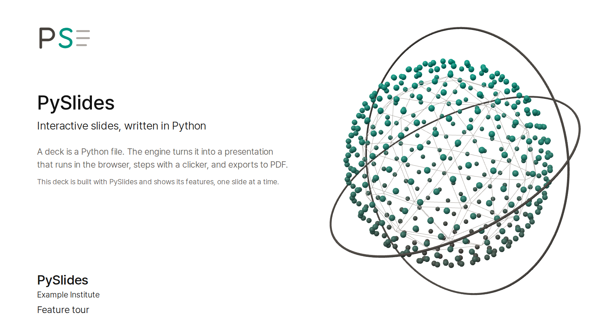
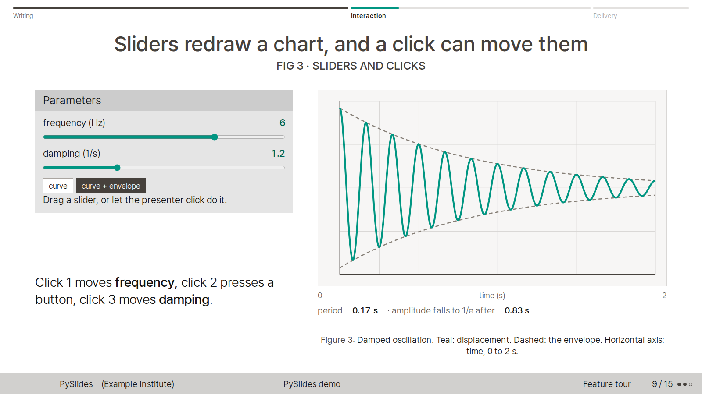
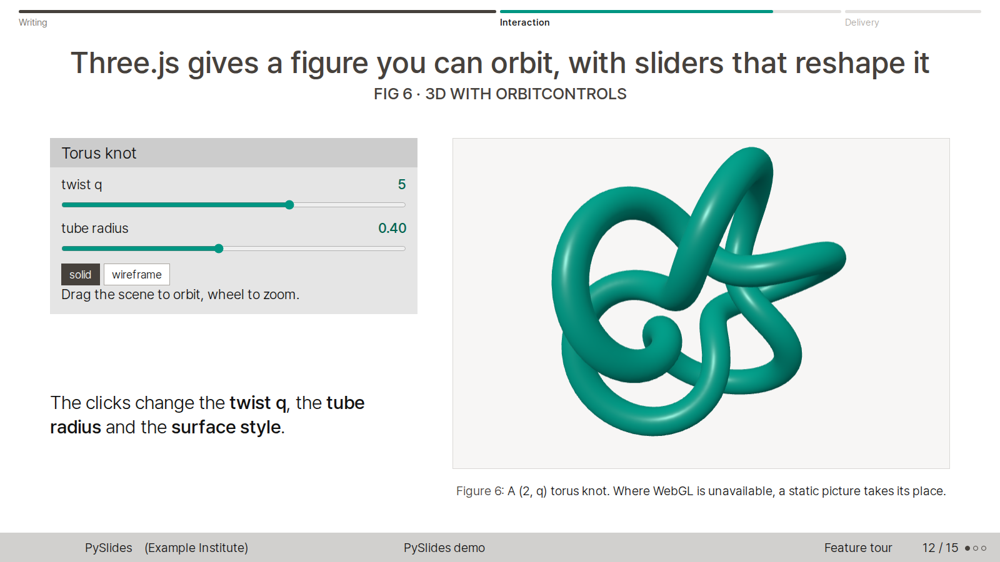
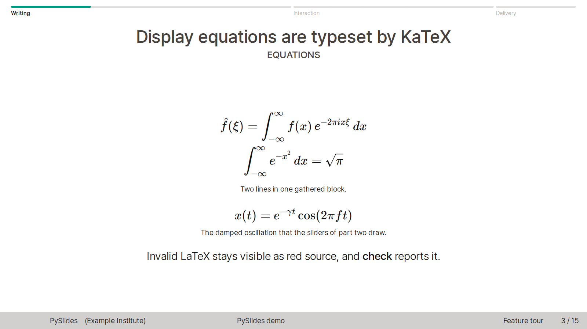

# PySlides

[English](README.md) | [한국어](README.ko.md) | [日本語](README.ja.md)

PySlides is an interactive slide engine in the style of the Beamer Singapore theme with the seagull color theme. You write slides in Python and present them in the browser.

- Slides are Python objects. Equations are LaTeX, typeset by the bundled KaTeX.
- Interactive components are supported: sliders, buttons, charts and Three.js 3D.
- Click steps let the presenter's clicks move the controls smoothly to preset values.
- A PDF export holds one page for every slide and every step, optionally with selectable text and vector figures.
- The `check` command screenshots every state and reports overflow, LaTeX errors and JavaScript errors.

## Screenshots

| Title slide | Interactive controls |
|---|---|
|  |  |

| 3D with Three.js | Math with KaTeX |
|---|---|
|  |  |

## Quick start

```bash
git clone https://github.com/BongHwi/pyslides-public.git
cd pyslides-public
python3 -m pyslides serve demo           # http://127.0.0.1:8765/
python3 -m pyslides new my-talk --title "My talk"
python3 -m pyslides serve my-talk
```

Authoring guide: [AUTHORING.md](AUTHORING.md) (English), [AUTHORING.ko.md](AUTHORING.ko.md) (Korean).

## Requirements

- Python 3.11 or newer to build and present (checked with 3.11 and 3.12).
- Node.js 18 or newer for `check`, `pdf` and the tests, with the dependencies and a Chromium for Playwright:

```bash
npm ci
npx playwright install chromium
```

- poppler-utils (`pdffonts`, `pdftotext`) for `npm test` and for the font check of `pdf --vector`. On Debian or Ubuntu: `sudo apt install poppler-utils`.

Presenting needs only Python. If Playwright cannot find a browser, set `PYSLIDES_BROWSER_EXECUTABLE` to the path of a chromium binary.

## Commands

```bash
python3 -m pyslides new my-talk --title "My talk"        # create decks/my-talk from the template
python3 -m pyslides list                                  # list the decks
python3 -m pyslides serve my-talk                         # build and present at http://127.0.0.1:8765/
python3 -m pyslides build my-talk                         # build only (reloads the browser if a server is running)
python3 -m pyslides check my-talk                         # screenshot every slide and step -> decks/my-talk/export/check/index.html
python3 -m pyslides pdf my-talk                           # decks/my-talk/export/my-talk.pdf
python3 -m pyslides pdf my-talk --vector                  # selectable text, vector figures, PDF links (canvas/WebGL stays an image)
```

Every subcommand has `--help`. `serve` takes `--port` and `--no-browser`, `check` and `pdf` take `-o`, `pdf` takes `--scale`, and `build`, `serve`, `check` and `pdf` take `--profile`. All options are described in the authoring guide.

## Demo deck

`decks/demo` introduces PySlides and uses every feature at least once: the title page with a Three.js graphic, inline and display math, figures and tables, layers and comparison cards, sliders, buttons and click steps, a live calculation in a worker, 3D with OrbitControls, a dial slide, Korean and Japanese text, a custom layout, and speaker notes.

```bash
python3 -m pyslides serve demo
```

## Profiles

A profile keeps personal settings (author, institute, logos, fonts) outside the decks and the engine. Point to a profile folder with `PYSLIDES_PROFILE` or `--profile`; the flag wins. The folder holds a `profile.json` and an optional `assets/` folder, which may contain `profile.css`.

```bash
export PYSLIDES_PROFILE=~/my-profile
python3 -m pyslides serve my-talk
python3 -m pyslides pdf my-talk --profile ~/my-profile
```

```json
{
  "author": "Your Name",
  "institute": ["Your Institute", "Your City"],
  "short_institute": "YI",
  "title_logos": ["logos/mark.svg"]
}
```

The precedence is the default theme, then the profile, then `Deck.theme`. Without a profile the author, institute and logos are empty. See the Profiles section of the authoring guide for the rules and the errors.

## Clicker and dial

- PageDown and PageUp from a presentation clicker advance and undo the steps, even when a slider or button has the focus.
- `Slide(..., dial="id")` lets a dial device that sends F17 (forward) and F16 (back) turn a range input or scrub a video. The demo deck has a working slide.
- `node tests/clicker-e2e.mjs --live` opens a visible browser and records the keys that a real clicker sends in `artifacts/clicker-live.json`.

## Agent skill

`skill/SKILL.md` is an agent skill for making, checking and exporting PySlides decks. Install it from a clone:

```bash
bash skill/install.sh                    # defaults to ~/.claude/skills/pyslides/SKILL.md
SKILLS_DIR=/path/to/skills bash skill/install.sh   # another agent's skills folder
```

The installer fills in the path of the clone and the URL of its `origin` remote. If an installed `SKILL.md` already exists and differs, it is copied to `SKILL.md.bak-<time>` first.

## Known limits

- The build uses absolute paths starting with `/`, so a deck works only at the root of a domain, not under a sub-path such as `/repo/`.
- The default PDF is a screen capture without searchable text. `pdf --vector` gives selectable text, but `<canvas>` and WebGL stay images and fonts declared with `src: local(...)` are not verified by the host-font check.
- The built-in interface text follows `Deck.lang` (`ko`, `en`, `ja`); other values give English.

## Tests

```bash
npm test                  # engine end-to-end tests; results in artifacts/*.json
npm run test:demo         # end-to-end tests of the demo deck; starts its own server
```

`npm test` runs the scaffold, robustness, clicker, vector-pdf and profile suites. Every suite ignores a `PYSLIDES_PROFILE` set in your shell. If Playwright cannot find a browser, run `npx playwright install chromium` or set `PYSLIDES_BROWSER_EXECUTABLE`. `test:demo` uses `PYSLIDES_URL` as the server address when it is set.

## Repository layout

| Path | Content |
|---|---|
| `pyslides/` | Python engine: model and rendering (`core.py`), build (`build.py`), CLI (`__main__.py`), default theme (`theme.py`) |
| `static/` | Browser runtime: `slides.js`, `steps.js`, `controls.js`, `theme.css`, fonts, KaTeX and Three.js |
| `tools/capture.mjs` | Captures every slide and step in turn; used by `pdf` and `check` |
| `templates/new-deck/` | The template that `new` copies |
| `decks/` | Decks. `decks/demo` is the demo deck |
| `skill/` | The agent skill and its installer |
| `docs/images/` | Screenshots for this README |
| [THEME_MAPPING.md](THEME_MAPPING.md) | How Beamer elements map to the HTML theme |

## License and third-party notices

PySlides is released under the MIT License: [LICENSE](LICENSE). The repository bundles KaTeX, three.js, Pretendard, LINE Seed JP and DejaVu fonts under their own licences, listed in [THIRD_PARTY_NOTICES.md](THIRD_PARTY_NOTICES.md).

## Author

Bong-Hwi Lim (The University of Tokyo)
